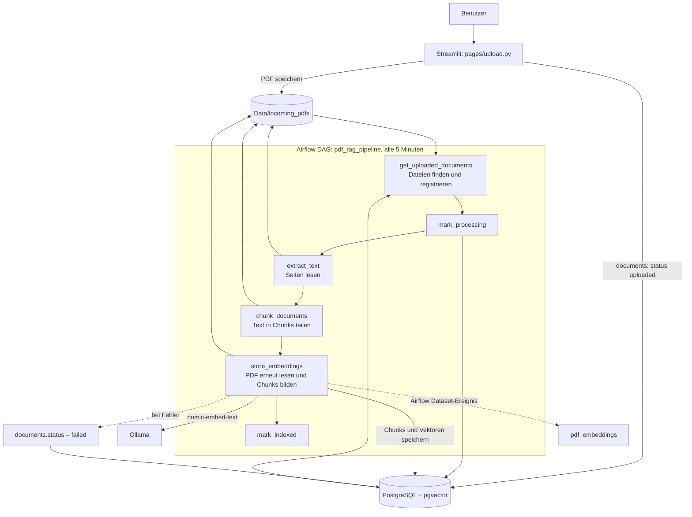
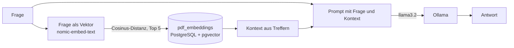
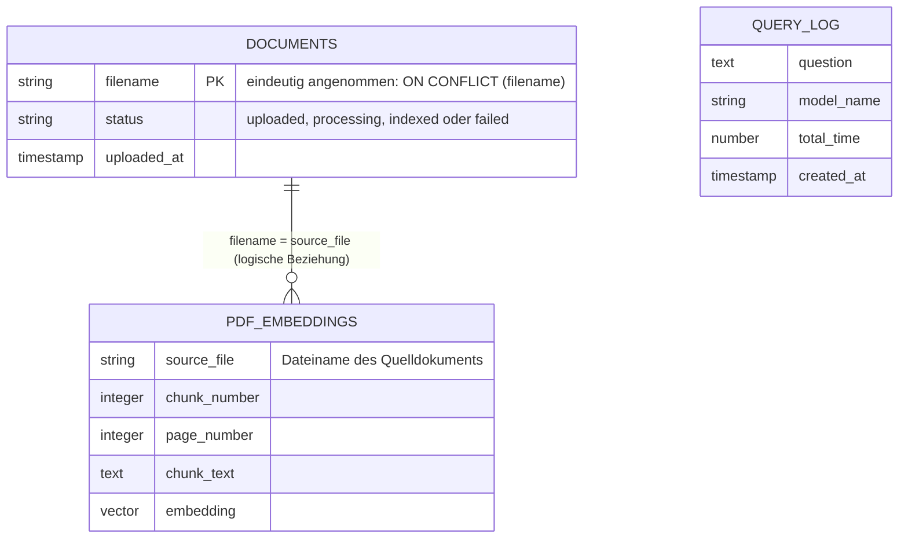

# RAG-Workflow und Datenmodell

Dieses Modell beschreibt die im Repository erkennbare PDF-RAG-Implementierung.
Die Diagramme dokumentieren den Ist-Zustand; sie ersetzen kein Datenbank-DDL.

## PDF-Indexierung

`chunk_documents` protokolliert die Chunk-Anzahl, speichert die Chunks aber
nicht. `store_embeddings` liest und chunked die PDFs deshalb erneut; dort
werden die Embeddings tatsächlich in `pdf_embeddings` geschrieben. Die
Chunk-Größe ist 1000 Zeichen mit 300 Zeichen Überlappung.

## Frage und Antwort

Dieser Suchpfad ist in `Scripts/pdf/search_test.py` umgesetzt. Er ist im
Repository nicht als Airflow-Task modelliert.

## Datenmodell

`DOCUMENTS` und `PDF_EMBEDDINGS` sind aus den Upload-, DAG- und Suchabfragen
abgeleitet. `filename` wird als eindeutig behandelt, weil der Code
`ON CONFLICT (filename)` verwendet. Die Beziehung zwischen `filename` und
`source_file` ist im Anwendungscode nachvollziehbar; ein Datenbank-Fremdschlüssel
oder Primärschlüssel für `PDF_EMBEDDINGS` ist im Repository nicht definiert.

`QUERY_LOG` ist separat aufgeführt, weil das Dashboard diese Spalten abfragt.
Im Repository ist jedoch weder ein DDL für diese Tabelle noch ein Schreibpfad
für die Anfragen enthalten. Ihre Existenz und Befüllung sind daher nicht durch
den Code belegt.
